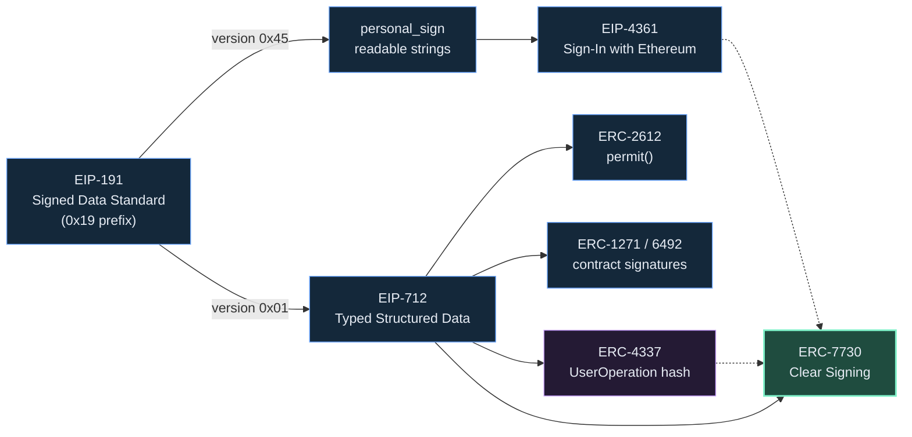
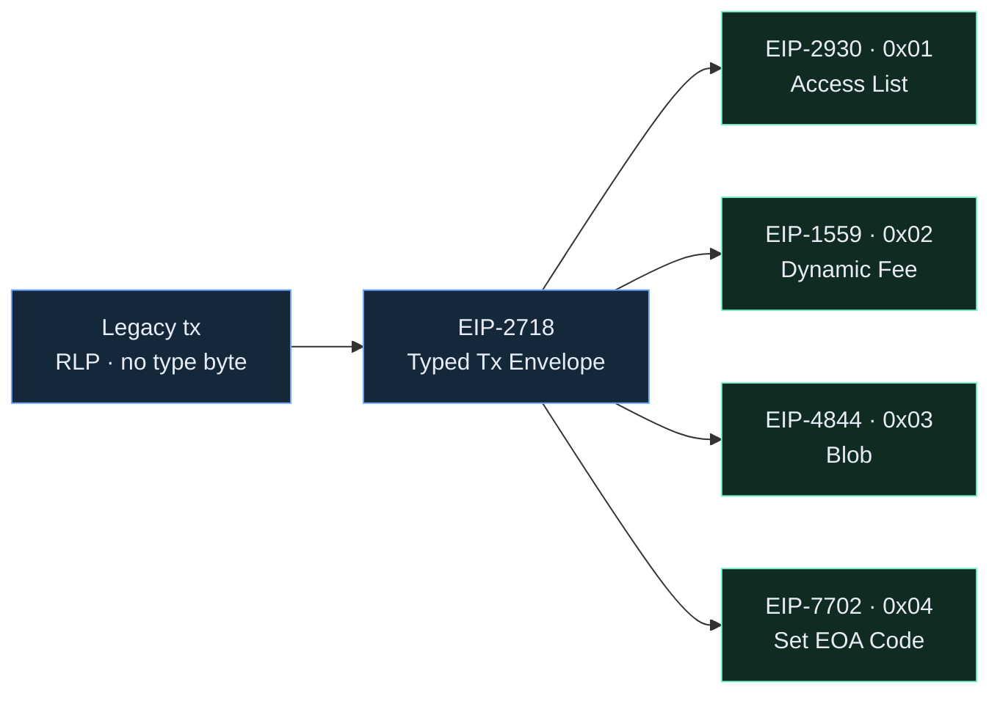
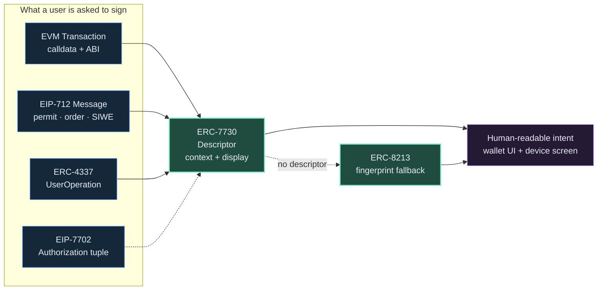

<div align="center">

# Awesome Clear Signing [](https://awesome.re)

*A curated list of standards, tools, registries, wallets, and knowledge for **Clear Signing** on Ethereum & the EVM — making transaction and message signing human-readable, so users know exactly what they approve.*

**Clear Signing** is the open standard ([ERC-7730](https://eips.ethereum.org/EIPS/eip-7730)) for turning opaque hexadecimal calldata, EIP-712 messages, and UserOperations into clear, contextual, human-readable intent at the moment of signing — the opposite of *blind signing*.

[Website](https://clearsigning.org) · [ERC-7730](https://eips.ethereum.org/EIPS/eip-7730) · [Registry](https://github.com/ethereum/clear-signing-erc7730-registry) · [Discussion](https://ethereum-magicians.org/t/eip-7730-proposal-for-a-clear-signing-standard-format-for-wallets/20403)

</div>

---

## Contents

- [What Is Clear Signing?](#what-is-clear-signing)
- [Why Blind Signing Is Dangerous — Notable Incidents](#why-blind-signing-is-dangerous--notable-incidents)
- [Standards & Specifications](#standards--specifications)
- [Official Resources](#official-resources)
- [Developer Tools & Builders](#developer-tools--builders)
- [Registries & Metadata](#registries--metadata)
- [Wallets & Implementations](#wallets--implementations)
- [Security, Simulation & Verification](#security-simulation--verification)
- [Libraries & SDKs](#libraries--sdks)
- [Articles, Talks & Learning](#articles-talks--learning)
- [Community & Governance](#community--governance)
- [Knowledge: EVM Messages, Transaction & Signing Formats](#knowledge-evm-messages-transaction--signing-formats)
- [Contributing](#contributing)

---

## What Is Clear Signing?

When you sign a blockchain transaction, your wallet often shows you a wall of hex — `0x38ed1739…` — or a raw EIP-712 struct with no explanation. **Blind signing** means approving something you cannot read, and it is the root cause of many drainer, phishing, and supply-chain losses.

**Clear Signing** solves this by pairing on-chain data with a machine-readable *descriptor* ([ERC-7730](https://eips.ethereum.org/EIPS/eip-7730)) that tells the wallet how to render intent — *"Swap 1.5 ETH for at least 4,200 USDC on Uniswap V3"* — including token amounts, recipients, and network, verifiable right down to the hardware wallet screen.

The initiative shipped as a **four-part suite**: **ERC-7730** descriptors, a neutral **registry**, **ERC-8176** auditor attestations, and **ERC-8213** cryptographic-fingerprint fallback — plus open developer libraries.

> **Stewards & contributors** include the Ethereum Foundation, Ledger, WalletConnect, Fireblocks, Sourcify, Trezor, Cyfrin, Zama, Keycard, ZKnox, MetaMask, and Blockaid. Governance of ERC-7730 was transferred from Ledger to the Ethereum Foundation for long-term neutrality.

---

## Why Blind Signing Is Dangerous — Notable Incidents

Clear signing is not academic — blind signing is a leading cause of catastrophic crypto loss. When signers cannot read what they approve, a manipulated UI or a misleading payload is indistinguishable from a legitimate transaction.

- **[Bybit — ~$1.5B (Feb 2025)](https://www.chainalysis.com/blog/bybit-exchange-hack-february-2025-crypto-security-dprk/)** — The largest crypto theft to date. A compromised Safe{Wallet} interface showed signers a normal-looking transfer while the underlying calldata swapped the wallet's control logic. The keys were never stolen — the signers were **blind-signing** a payload they couldn't verify. The canonical clear-signing cautionary tale. `incident`
- **[FBI / IC3 advisory on the Bybit hack](https://www.ic3.gov/psa/2025/psa250226)** — Official attribution (DPRK "TraderTraitor"), useful primary source on the attack pattern. `reference`
- **[Radiant Capital — ~$50M (Oct 2024)](https://rekt.news/radiant-capital-rekt2)** — Multisig signers approved malicious transactions via a compromised front-end that displayed benign data while different calldata was signed on their hardware wallets. `incident`

> The through-line: **What You See Is What You Sign (WYSIWYS)** must be the default. Clear signing + independent verification (fingerprints, simulation) is the defense.

---

## Standards & Specifications

The Ethereum standards that make clear signing possible — the formats being signed and the descriptor formats that explain them.

### How the standards fit together

**1 · Evolution of signing standards.** Everything descends from the `0x19` prefix of EIP-191. Typed data (EIP-712) unlocked structured, replay-safe signing that permits, orders, contract signatures, account abstraction, and finally clear signing all build on.



**2 · Evolution of the transaction envelope.** EIP-2718 turned the single legacy format into a typed envelope, so each later fee/data feature ships as a new type byte — all valid clear-signing targets.



**3 · What ERC-7730 unifies.** Clear signing sits on top of *both* pipelines — decoding transaction calldata (via ABIs) **and** off-chain EIP-712 messages — and renders one human-readable intent. When no descriptor resolves, **ERC-8213** shows a reproducible fingerprint as a fallback.



### The clear-signing suite

- **[ERC-7730 — Structured Data Clear Signing Format](https://eips.ethereum.org/EIPS/eip-7730)** — The core standard. JSON descriptors that enrich ABIs and EIP-712 schemas with formatting + intent metadata. `spec`
- **[ERC-7730 spec (registry copy)](https://github.com/ethereum/clear-signing-erc7730-registry/blob/master/specs/erc-7730.md)** — Canonical, versioned spec text maintained in the registry repo. `spec`
- **[ERC-8213 — Cryptographic Fingerprints](https://erc8213.eth.limo/)** — Fallback for cases 7730 can't reach: a short, reproducible fingerprint of the exact bytes being signed, verifiable on a second device. `spec`
- **[ERC-8176 — Descriptor Attestations](https://eip.tools/eip/8176)** — An EAS-based framework letting auditors cryptographically attest that a descriptor matches verified on-chain code. `spec`

### Formats being signed

- **[EIP-712 — Typed Structured Data Hashing and Signing](https://eips.ethereum.org/EIPS/eip-712)** — Human-readable typed message signing; the basis for permits, orders, and UserOp hashes. `spec`
- **[EIP-191 — Signed Data Standard](https://eips.ethereum.org/EIPS/eip-191)** — The `0x19` prefix scheme that namespaces signed data (version `0x01` = EIP-712). `spec`
- **[ERC-1271 — Standard Signature Validation for Contracts](https://eips.ethereum.org/EIPS/eip-1271)** — `isValidSignature`; how smart-contract wallets prove they signed a message. `spec`
- **[ERC-6492 — Signature Validation for Predeploy Contracts](https://eips.ethereum.org/EIPS/eip-6492)** — Extends ERC-1271 to counterfactual (not-yet-deployed) smart accounts. `spec`
- **[ERC-2612 — permit()](https://eips.ethereum.org/EIPS/eip-2612)** — Canonical gasless-approval EIP-712 permit for ERC-20 tokens. `spec`
- **[ERC-3009 — transferWithAuthorization](https://eips.ethereum.org/EIPS/eip-3009)** — Signed one-time transfer authorization used by USDC/PYUSD; a frequently blind-signed message type. `spec`
- **[ERC-4337 — Account Abstraction via EntryPoint](https://eips.ethereum.org/EIPS/eip-4337)** — Defines the `UserOperation` — a first-class clear-signing target. `spec`
- **[EIP-7702 — Set EOA Account Code](https://eips.ethereum.org/EIPS/eip-7702)** — Lets an EOA delegate to contract code via a signed authorization tuple. `spec`
- **[EIP-2718 — Typed Transaction Envelope](https://eips.ethereum.org/EIPS/eip-2718)** — The envelope that makes new transaction types (1559, 2930, 4844, 7702) possible. `spec`
- **[EIP-1559 — Fee Market](https://eips.ethereum.org/EIPS/eip-1559)** — The default `0x02` dynamic-fee transaction type. `spec`
- **[Cyfrin EIP/ERC Glossary](https://www.cyfrin.io/glossary/eip-191)** — Plain-language reference entries for EIP-191, 712, 4337, and more. `reference`

## Official Resources

- **[clearsigning.org](https://clearsigning.org)** — The initiative's home: overview, ecosystem, build guides, and governance. `official`
- **[Ledger Clear Signing Docs](https://developers.ledger.com/docs/clear-signing/references/erc7730-standard)** — The most complete developer documentation for ERC-7730. `official`
- **[ERC-7730 Specifications (Ledger)](https://developers.ledger.com/docs/clear-signing/reference/specifications)** — Field-by-field reference for writing descriptors. `official`
- **[External Resources (Ledger)](https://developers.ledger.com/docs/clear-signing/reference/external-resources)** — Curated links from the Ledger dev portal. `official`
- **[Ethereum Magicians — ERC-7730 thread](https://ethereum-magicians.org/t/eip-7730-proposal-for-a-clear-signing-standard-format-for-wallets/20403)** — The canonical governance and design discussion thread. `community`

## Developer Tools & Builders

Build, validate, preview, and audit clear-signing descriptors.

- **[LedgerHQ/clear-signing-erc7730-developer-tools](https://github.com/LedgerHQ/clear-signing-erc7730-developer-tools)** — Original open-source Builder, Linter, Tester, and Analyzer. **(Archived — read-only)**; superseded by the libraries below. `tool`
- **[python-erc7730](https://github.com/LedgerHQ/python-erc7730)** — Maintained Python library + CLI to build, parse, validate, lint, and convert ERC-7730 descriptors. `tool`
- **[Cyfrin/clearsig](https://github.com/Cyfrin/clearsig)** — Python toolkit (`clearsig` CLI) for ERC-7730 descriptors and ERC-8213 fingerprints. `tool`
- **[WhatsABI](https://github.com/shazow/whatsabi)** — Extract the ABI and resolve proxies straight from bytecode — decode contracts even without verified source. `tool`
- **[Safe Transaction Data Decoder](https://docs.safe.global/core-api/transaction-service-guides/data-decoder)** — Decode Safe multisig calldata via the Transaction Service (pulls ABIs from Sourcify/Etherscan). `tool`
- **[safe-tx-hashes-util](https://github.com/pcaversaccio/safe-tx-hashes-util)** — Independently reproduce and verify a Safe EIP-712 transaction hash — a direct blind-signing countermeasure for multisig signers. `tool`
- **[Speculos](https://github.com/LedgerHQ/speculos)** — Emulate a Ledger device to preview how a descriptor renders on-screen. `tool`

## Registries & Metadata

Where descriptors and contract metadata live so wallets can resolve intent.

- **[ERC-7730 Registry](https://github.com/ethereum/clear-signing-erc7730-registry)** — The canonical, open registry of descriptors, plus the spec — submit yours via PR. `official`
- **[Sourcify](https://sourcify.dev)** — Decentralized source-code & metadata verification; a key input for trustworthy decoding. `reference`
- **[OpenChain (openchain.xyz)](https://openchain.xyz)** — Large signature registry (function selectors + event topics), now Sourcify-hosted. `reference`
- **[Etherscan Verified Contracts](https://etherscan.io/contractsVerified)** — Verified ABIs used to decode calldata into named functions and params. `reference`
- **[4byte Directory](https://www.4byte.directory)** — Reverse-lookup of 4-byte function selectors → signatures. `reference`
- **[Dedaub Decompiler](https://app.dedaub.com)** — Reconstructs readable pseudo-Solidity from on-chain bytecode when no ABI exists. `tool`

## Wallets & Implementations

Wallets and platforms that render clear-signing intent to users.

- **[Ledger](https://www.ledger.com)** — Originated Clear Signing (2023) and ERC-7730; renders descriptors on-device. `wallet`
- **[Trezor](https://trezor.io)** — Hardware wallet steward contributing to the standard. `wallet`
- **[MetaMask](https://metamask.io)** — Decoding + simulation and signature-insight for transactions and messages. `wallet`
- **[MetaMask Signature Insights (Snaps)](https://docs.metamask.io/snaps/features/signature-insights/)** — `onSignature` API to decode and annotate signature requests in the confirmation UI. `tool`
- **[Rabby](https://rabby.io)** — Pre-sign simulation, balance-change preview, approval breakdown, and scam scoring — a reference clear-signing software wallet. `wallet`
- **[WalletConnect](https://walletconnect.network)** — Connection layer surfacing decoded intent across dApps and wallets. `wallet`
- **[Fireblocks](https://www.fireblocks.com)** — Institutional signing with policy + transaction transparency. `wallet`
- **[Keycard](https://keycard.tech)** — Open smartcard hardware wallet contributor. `wallet`

## Security, Simulation & Verification

Complementary layers — decode, simulate, and score a transaction before signing.

- **[Blockaid](https://www.blockaid.io)** — Transaction simulation + threat detection at the point of signature (used by MetaMask, Ledger, Coinbase). `security`
- **[Tenderly Simulator](https://tenderly.co/transaction-simulator)** — Simulate state changes of a transaction before submitting. `security`
- **[Cyfrin](https://www.cyfrin.io)** — Smart-contract security education and audits; ERC-7730 / ERC-8213 contributor. `security`
- **[Ledger "Transaction Check"](https://www.blockaid.io/blog/how-blockaid-helps-ledgers-transaction-check-mitigate-blind-signing-risks)** — Blockaid-powered warnings that mitigate blind-signing risk. `article`
- **[Transaction Verification vs. Blind Signing](https://www.blockaid.io/blog/transaction-verification-a-solution-to-blind-signing-in-hardware-wallets)** — Why simulation must be cryptographically bound to what's signed. `article`

## Libraries & SDKs

- **[viem](https://viem.sh)** — TypeScript library with first-class EIP-712 typed-data signing & hashing. `tool`
- **[ethers.js](https://docs.ethers.org)** — `signTypedData` / EIP-712 helpers and ABI encoding. `tool`
- **[abitype](https://abitype.dev)** — Strict TypeScript types for ABIs and EIP-712 typed data. `tool`
- **[micro-eth-signer](https://www.npmjs.com/package/micro-eth-signer)** — Minimal, audited, dependency-light library for signing/decoding EVM transactions, EIP-712 typed data, and messages — small enough to fully audit. `tool`
- **[permit2 (Uniswap)](https://github.com/Uniswap/permit2)** — Canonical EIP-712 permit patterns worth clear-signing correctly. `reference`

## Articles, Talks & Learning

### Blogs & tutorials

- **[Add clear signing to your protocol with ERC-7730 (ethereum.org)](https://ethereum.org/developers/tutorials/clear-signing/)** — Official hands-on tutorial for writing descriptors. `article`
- **[Implement EIP-7730 today (Trail of Bits)](https://blog.trailofbits.com/2025/08/27/implement-eip-7730-today/)** — Security-firm walkthrough of writing a descriptor for a Uniswap swap, with the tradeoffs spelled out. `article`
- **[Blind Signing — Solved? (Cyfrin)](https://www.cyfrin.io/blog/blind-signing-solved)** — Launch-day overview of the 7730 / 8176 / 8213 suite, with `clearsig` examples. `article`
- **[Solving Blind Signing: ERC-7730 and ERC-8213 (Beosin)](https://beosin.com/resources/solving-blind-signing-an-analysis-of-erc-7730-and-erc-8213)** — Technical comparison of the descriptor vs. fingerprint approaches. `article`
- **[What Is Clear Signing? ERC-7730 Explained (Ambire)](https://blog.ambire.com/clear-signing-erc-7730/)** — Approachable intro with before/after `approve()` examples. `article`
- **[What is ERC-7730? (QuickNode)](https://www.quicknode.com/blog/erc-7730-clear-signing-standard)** — Developer explainer that's honest about the limits (readable ≠ verified). `article`
- **[ERC-7730 v2 & The Evolution of Clear Signing (Ledger)](https://www.ledger.com/blog-the-evolution-of-clear-signing)** — Ledger's overview of the standard's direction. `article`
- **[EIP-712 explained (blockchain-wiki)](https://github.com/fullstack-development/blockchain-wiki-en/blob/main/EIPs/eip-712/README.md)** — Deep dive on typed-data hashing. `article`
- **[Guide for Wallet Devs: EIP-7702 + ERC-4337](https://erc4337.substack.com/p/guide-for-wallet-devs-for-getting)** — How the two combine for smart-account UX. `article`
- **[Is WalletConnect Safe? v2 Security Guide](https://ndlabs.dev/is-walletconnect-safe)** — Threat model behind approval-based drainer scams. `article`

### Videos & talks

- **[You can SEE what you sign now?? — ERC-7730, 8213 & Clear Signing (Cyfrin / Patrick Collins)](https://www.youtube.com/watch?v=k5__eA1AH-w)** — Developer-focused walkthrough of the full suite. `video`
- **[Why Blind Signing Is Killing DeFi — Ledger x 1inch (The Ledger Podcast)](https://www.youtube.com/watch?v=KKSPk9CahYE)** — Why blind signing persists in DeFi and how clear signing fixes it. `video`
- **[Clear Signing Explained: How Ledger Protects Your Digital Assets (The Ledger Podcast)](https://www.youtube.com/watch?v=eMMa62cN88w)** — Accessible overview of the "know what you sign" problem in self-custody. `video`

## Community & Governance

- **[Ethereum Foundation](https://ethereum.org/foundation)** — Now stewards ERC-7730 governance. `community`
- **[Ethereum Magicians](https://ethereum-magicians.org)** — Standards discussion forum. `community`
- **[ERC-7730 Registry Issues](https://github.com/ethereum/clear-signing-erc7730-registry/issues)** — Propose changes, report gaps, submit descriptors. `community`

---

## Knowledge: EVM Messages, Transaction & Signing Formats

*The heart of clear signing is understanding **what** is actually being signed.* This section maps the formats a wallet may ask you to approve — and where clear signing applies to each.

### Two things you can sign

| | Transactions | Off-chain messages |
|---|---|---|
| **What it is** | State-changing operations broadcast to the network and mined | Signatures proving intent/authorization, **not** broadcast on their own |
| **Costs gas?** | Yes | No (until relayed/settled by someone) |
| **Examples** | ETH transfer, contract call, token approval | Login (SIWE), `permit`, limit orders, `UserOperation`, EIP-7702 authorization |
| **Signing schemes** | Type-prefixed RLP (see below) | EIP-191 / EIP-712 (plus payload-specific schemes, e.g. EIP-7702's `0x05`) |
| **Clear signing via** | Decode calldata + ERC-7730 descriptor | ERC-7730 descriptor on the EIP-712 schema |

### EVM transaction types (EIP-2718 typed envelope)

Since [EIP-2718](https://eips.ethereum.org/EIPS/eip-2718), each transaction begins with a **type byte** that selects how the remaining payload is decoded. A leading byte `≥ 0xc0` means a legacy (untyped) RLP transaction — legacy txs have **no** type byte on the wire (`0x00` only appears as a synthetic value in some JSON-RPC responses).

| Type | Name | Introduced by | Key fields added |
|---|---|---|---|
| — (legacy) | Legacy | pre-Berlin | `nonce, gasPrice, gasLimit, to, value, data, v, r, s` |
| `0x01` | Access List | [EIP-2930](https://eips.ethereum.org/EIPS/eip-2930) | `accessList`, explicit `chainId` |
| `0x02` | Dynamic Fee | [EIP-1559](https://eips.ethereum.org/EIPS/eip-1559) | `maxFeePerGas`, `maxPriorityFeePerGas` |
| `0x03` | Blob | [EIP-4844](https://eips.ethereum.org/EIPS/eip-4844) | `maxFeePerBlobGas`, `blobVersionedHashes` |
| `0x04` | Set Code | [EIP-7702](https://eips.ethereum.org/EIPS/eip-7702) | `authorizationList` (delegate EOA → contract) |

**Anatomy of a call.** For a contract interaction, the human-meaningful part lives in the `data` (calldata) field:

```text
0xa9059cbb                                                        ← 4-byte selector: transfer(address,uint256)
  000000000000000000000000ab5801a7d398351b8be11c439e05c5b3259aec9b  ← arg 1: recipient (address, left-padded to 32 bytes)
  0000000000000000000000000000000000000000000000000de0b6b3a7640000  ← arg 2: amount = 1e18 (1 token, 18 decimals)
```

A blind-signing wallet shows the raw hex. A **clear-signing** wallet uses the ABI + an ERC-7730 descriptor to render: *"Send 1.0 TKN to 0xAB58…AEC9b."*

### Off-chain message signing schemes

| Scheme | Prefix / format | What it's for | Risk if blind-signed |
|---|---|---|---|
| **`eth_sign`** | raw 32-byte hash, no prefix | Legacy raw-hash signing | **High** — can be a disguised transaction hash. Most wallets warn/block. |
| **`personal_sign` (EIP-191 `0x45`)** | `"\x19Ethereum Signed Message:\n" + len + msg` | Human-readable string signing, logins | **Medium** — safer, but phrasing can still mislead |
| **[SIWE (EIP-4361)](https://eips.ethereum.org/EIPS/eip-4361)** | structured `personal_sign` text | "Sign-In with Ethereum" auth | **Low** — structured & readable |
| **EIP-712 (EIP-191 `0x01`)** | `0x19 0x01 ‖ domainSeparator ‖ hashStruct(message)` | Typed data: permits, orders, UserOps | **Medium** — readable *if* the wallet renders the struct + descriptor |
| **[ERC-1271](https://eips.ethereum.org/EIPS/eip-1271) / [ERC-6492](https://eips.ethereum.org/EIPS/eip-6492)** | `isValidSignature` on the account contract | How **smart-contract wallets** sign the above | **Medium** — adds a contract-verification hop the wallet must surface honestly |

**EIP-191 byte layout:**

```text
0x19  <1-byte version>  <version-specific data>  <data to sign>
      0x00 → intended validator     (address of validator)
      0x01 → structured data         (EIP-712: domainSeparator)
      0x45 'E' → personal_sign       ("thereum Signed Message:\n" + len)
```

**EIP-712 digest that actually gets signed:**

```text
digest = keccak256( 0x19 ‖ 0x01 ‖ domainSeparator ‖ hashStruct(message) )

domainSeparator = hashStruct(EIP712Domain{ name, version, chainId, verifyingContract, salt })
hashStruct(s)   = keccak256( typeHash ‖ encodeData(s) )
typeHash        = keccak256( "Transfer(address to,uint256 amount)" )
```

Binding to `chainId` and `verifyingContract` is what prevents a signature from being replayed on another chain or contract — a core reason EIP-712 is preferred for anything with value.

### ERC-4337 UserOperations

A `UserOperation` is a **pseudo-transaction** for smart accounts. As of **EntryPoint v0.8**, it is hashed as **EIP-712 over the EntryPoint's domain** (so the hash depends on `chainId` and the EntryPoint address, preventing replay), then bundled and submitted by a bundler:

```text
UserOpHash (v0.8) = keccak256( 0x19 ‖ 0x01 ‖ entryPointDomainSeparator ‖ hashStruct(userOp) )
```

**Note:** earlier, still-dominant **EntryPoint v0.6 / v0.7** hash *without* EIP-712 — a plain ABI-encoded hash:

```text
userOpHash (v0.6/0.7) = keccak256( abi.encode( keccak256(packedUserOp), entryPoint, chainId ) )
```

Either way, replay protection comes from binding `entryPoint` + `chainId`. Fields a clear-signing wallet should surface include `sender`, `callData`, `callGasLimit`, `maxFeePerGas`, `nonce`, and the paymaster data (`paymasterAndData` in v0.6; split into `paymaster` / `paymasterData` / gas limits in v0.7+).

### EIP-7702 authorizations

EIP-7702 (which superseded the earlier EIP-3074 `AUTH`/`AUTHCALL` design) lets an EOA sign an **authorization tuple** `(chainId, address, nonce)` delegating its code to a contract. It is signed as `keccak256(0x05 ‖ rlp([chainId, address, nonce]))` — its own `0x05` magic byte, distinct from EIP-191/712. Because signing one grants a contract the power to act *as your account*, clear rendering of the delegate address is safety-critical.

### The ERC-7730 descriptor (how intent is defined)

A descriptor is JSON with two halves — **`context`** (what schema it binds to: an EVM contract ABI or an EIP-712 domain) and **`display`** (how to format each function/message into fields):

```json
{
  "context": {
    "contract": { "abi": "…", "deployments": [{ "chainId": 1, "address": "0x…" }] }
  },
  "display": {
    "formats": {
      "transfer(address,uint256)": {
        "intent": "Send",
        "fields": [
          { "path": "to",     "label": "To",     "format": "addressName" },
          { "path": "amount", "label": "Amount", "format": "tokenAmount",
            "params": { "tokenPath": "@.to", "nativeCurrencyAddress": "…" } }
        ]
      }
    }
  }
}
```

The wallet resolves the descriptor for the target contract/message, applies each field `format` (e.g. `tokenAmount`, `addressName`, `date`, `amount`, `raw`), interpolates on-chain values, and shows the result — the same on a phone screen and a hardware-wallet display. If no descriptor exists, [ERC-8213](https://erc8213.eth.limo/) fingerprints let the user still verify the exact bytes.

### Reader's checklist before you sign

- **Is it a message or a transaction?** A raw-hash `eth_sign` prompt is a red flag.
- **Does the intent match the app?** "Approve unlimited" on a page you thought was a swap = stop.
- **Right `chainId` and `verifyingContract`?** Domain mismatch = possible replay/phishing.
- **Amounts, decimals, recipient** rendered in human units — not raw `uint256`.
- **Simulated + verified?** Clear signing + simulation (Blockaid/Tenderly) + fingerprints (ERC-8213) is defense in depth.

---

## Contributing

Contributions welcome! Please read [`CONTRIBUTING.md`](CONTRIBUTING.md). In short:

- One link per entry, `Name — one-line description.` with a trailing category tag.
- Keep it **relevant to clear signing** on Ethereum/EVM (standards, tools, registries, wallets, security, learning).
- No dead links, no pure marketing. Prefer primary sources (specs, repos, docs).
- Open a PR — descriptor submissions for real contracts go to the [ERC-7730 registry](https://github.com/ethereum/clear-signing-erc7730-registry), not here.

## License

[](https://creativecommons.org/publicdomain/zero/1.0/)

To the extent possible under law, contributors have waived all copyright and related rights to this work. See [`LICENSE`](LICENSE).
